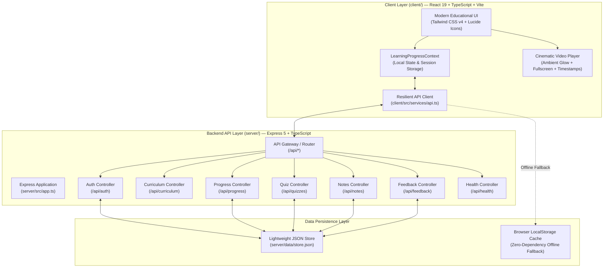

# VidyaPath — Educational Platform for School Students

> **Tagline:** Learn Step by Step. Grow Every Day.  
> **Academic Domain:** EPICS (Engineering Projects in Community Service) — Educational Technology Division  
> **Target Audience:** School Students in Classes 8, 9, 10, 11, and 12 (NCERT & State Boards)

---

## 1. Project Overview & Motivation

In secondary school education across India, millions of students rely on YouTube and open web resources for self-study and board examination preparation. While countless hours of high-quality educational video lectures exist (such as Physics Wallah, NCERT Wallah, and Foundation batches), self-studying students face critical friction points:

- **Algorithmic Distraction Loops:** Video recommendation feeds optimize for engagement and entertainment rather than focused curriculum mastery.
- **Unstructured Information Scatter:** Free videos lack a single-threaded sequential roadmap; learners cannot easily determine prerequisites or follow a structured syllabus.
- **The Missing Educational Triad:** Explanatory video lectures are decoupled from concise formula cheat-sheets, textbook study notes, and instant retention check quizzes.

**VidyaPath** bridges this gap. It organizes school curricula into an intuitive, step-by-step roadmap where students watch verified chapter-wise lectures, revise core formulas, take interactive quizzes, take timestamped personal notes, and track real-time mastery.

---

## 2. Full-Stack System Architecture

VidyaPath uses a clean, decoupled monorepo architecture with distinct **`client/`** and **`server/`** workspaces:



---

## 3. Separated Repository Structure

```text
VidyaPath/
├── package.json               # Root monorepo workspace coordinator
├── package-lock.json
├── tsconfig.json              # Solution-level TypeScript references
├── .gitignore                 # Universal gitignore (client & server builds, env, data)
├── .env.example               # Environment variables template
├── .env                       # Local environment configuration
├── README.md                  # Comprehensive platform documentation
│
├── client/                    # React 19 + TypeScript Frontend
│   ├── package.json           # Frontend dependencies & scripts
│   ├── vite.config.ts         # Vite config with Tailwind v4 & /api proxy to :5000
│   ├── index.html             # HTML5 entry template
│   ├── tsconfig.json          # Frontend TypeScript solution
│   ├── tsconfig.app.json
│   ├── tsconfig.node.json
│   ├── public/                # Static public assets (favicons, SVG icons)
│   │   ├── favicon.svg
│   │   ├── icons.svg
│   │   └── logo.png
│   └── src/
│       ├── main.tsx           # React DOM client entry
│       ├── App.tsx            # Protected routing & main shell
│       ├── index.css          # Global educational typography & Tailwind v4
│       ├── assets/            # Curated 3D illustrations & branding
│       ├── components/        # Cards, VideoPlayer, Quiz, Notes, Breadcrumbs
│       ├── context/           # LearningProgressContext (reactive state)
│       ├── data/              # NCERT curriculum & PW catalogs
│       ├── pages/             # All routed page views
│       ├── services/          # Resilient API client (api.ts)
│       ├── types/             # Frontend interfaces
│       └── utils/             # Safe storage helpers
│
└── server/                    # Express 5 + TypeScript Backend
    ├── package.json           # Backend dependencies & scripts
    ├── tsconfig.json          # NodeNext backend TypeScript config
    ├── .env                   # Server environment variables
    ├── .env.example
    ├── data/                  # Persistent JSON storage directory
    │   └── store.json         # Local database store (auto-generated)
    └── src/
        ├── index.ts           # Server bootstrap & graceful shutdown
        ├── app.ts             # Express application & middleware setup
        ├── controllers/       # Auth, Curriculum, Progress, Quiz, Notes, Feedback
        ├── middleware/        # Centralized error handler
        ├── routes/            # REST API route handlers
        ├── store/             # In-memory and persistent file store engine
        └── types/             # Backend TypeScript interfaces
```

---

## 4. Technology Stack

### Frontend Core (`client/`)
- **Framework:** React 19 (`react`, `react-dom`)
- **Build Tool:** Vite 8 (`vite`, `@vitejs/plugin-react`)
- **Routing:** React Router v7 (`react-router-dom`)
- **Styling:** Tailwind CSS v4 (`@tailwindcss/vite`) with custom educational palette
- **Iconography:** Lucide React (`lucide-react`)
- **Celebration Feedback:** Canvas Confetti (`canvas-confetti`)

### Backend API (`server/`)
- **Runtime:** Node.js v18+ (tested on v24)
- **Framework:** Express 5 (`express`)
- **TypeScript Engine:** `tsx` for high-speed execution & watch mode
- **Middleware:** `cors` for cross-origin management, `dotenv` for environment management
- **Storage:** Embedded Zero-Dependency JSON Persistence Engine (`server/data/store.json`)

---

## 5. How to Run

### Method 1: Run Both from Root (Single Command — Recommended)

From the root directory `D:\VidyaPath`:

```bash
npm run dev
```

This starts both services concurrently:
- **Frontend:** [http://localhost:5173](http://localhost:5173)
- **Backend API:** [http://localhost:5000](http://localhost:5000)

---

### Method 2: Run Separately in Dedicated Terminals

#### Terminal 1 — Frontend (Client):
```bash
cd client
npm run dev
```
> Starts Vite development server at [http://localhost:5173](http://localhost:5173)

#### Terminal 2 — Backend (Server):
```bash
cd server
npm run dev
```
> Starts Express API server at [http://localhost:5000](http://localhost:5000)

---

## 6. REST API Reference

Base URL: `http://localhost:5000/api` (automatically proxied in client dev server as `/api`)

| Method | Endpoint | Description | Sample Request / Body |
| :--- | :--- | :--- | :--- |
| **GET** | `/health` | Server health check & uptime status | — |
| **POST** | `/auth/login` | Student login / auto-registration | `{"name": "Aarav", "classLevel": "10"}` |
| **GET** | `/auth/me` | Fetch authenticated user profile | Header: `x-user-id: <userId>` |
| **POST** | `/auth/logout` | Terminate session | — |
| **GET** | `/curriculum/classes` | Fetch all supported classes (8–12) | — |
| **GET** | `/curriculum/classes/:id` | Fetch specific class syllabus | — |
| **GET** | `/curriculum/search?q=:query` | Search topics, chapters, and axioms | — |
| **GET** | `/progress/:userId` | Get user's completed topics & stats | — |
| **POST** | `/progress/toggle` | Toggle completion for a topic | `{"userId": "demo", "topicId": "top-1-1"}` |
| **POST** | `/progress/sync` | Bulk sync client state to server | `{"userId": "demo", "completedTopics": [...]}` |
| **POST** | `/progress/reset/:userId` | Reset progress to fresh state | — |
| **GET** | `/quizzes/:chapterId` | Retrieve practice quiz for chapter | — |
| **POST** | `/quizzes/submit` | Grade submitted answers & compute % | `{"chapterId": "ch-1", "answers": [1, 2, 0]}` |
| **GET** | `/notes/:userId/:topicId` | Fetch personal notes for a topic | — |
| **POST** | `/notes/:userId/:topicId` | Save/update topic study notes | `{"content": "Important board axiom..."}` |
| **DELETE** | `/notes/:userId/:topicId` | Delete study notes for a topic | — |
| **POST** | `/feedback` | Submit EPICS evaluation feedback | `{"userType": "Teacher", "difficulty": "..."}` |
| **GET** | `/feedback` | Retrieve community feedback log | — |

---

## 7. Offline-First Synchronization

VidyaPath guarantees uninterrupted learning even with intermittent or zero internet connectivity:
1. **Local State Supremacy:** The React frontend maintains all progress, quiz scores, and study notes in safe browser storage (`localStorage`).
2. **Graceful Fallback:** If the backend server is unreachable or offline, the API client automatically falls back to local storage without raising unhandled errors.
3. **Background Sync:** Once the network or server resumes, updates synchronize seamlessly to the persistent store.

---

## 8. EPICS Academic Project Attribution

- **Program:** Engineering Projects in Community Service (EPICS)
- **Focus Area:** Rural & Semi-Urban School Education Technology
- **Beneficiaries:** High School & Senior Secondary Students preparing for Board Exams without expensive coaching subscriptions.
- **Pedagogical Alignment:** NCERT / CBSE curriculum frameworks.

---

## 9. License

This project is licensed under the MIT License — free for community educators, schools, and self-studying students.
